# MediVision AI — System Analysis & Design Document (SADD / SDD)

**Document Version:** 1.0.0  
**Standard Reference:** IEEE Std 1016-2009 (*Standard for Information Technology — Systems Design — Software Design Descriptions*) & ISO/IEC/IEEE 42010:2011 (*Systems and software engineering — Architecture description*)  
**Project Classification:** Clinical Multimodal Artificial Intelligence Platform & Clinical Decision Support System (CDSS)  
**System Name:** MediVision AI  
**Academic & Institutional Affiliation:** Digital Egypt Pioneers Initiative (DEPI), Ministry of Communications and Information Technology (MCIT), Egypt  
**Status:** Baseline Audited & Implementation-Verified  

---

## Executive Summary

**MediVision AI** is a clinical-grade multimodal artificial intelligence platform engineered to bridge the operational gap between preventive laboratory risk assessment and acute radiological screening. In contemporary healthcare environments, diagnostic systems are fundamentally siloed: electronic medical records (EMRs) house tabular physiological and laboratory biomarkers in isolation from Picture Archiving and Communication Systems (PACS) that store radiographic studies. Consequently, attending physicians and emergency clinicians must manually aggregate heterogeneous signals under severe clinical time constraints.

MediVision AI addresses this structural fragmentation through a synchronized dual-engine architecture:
1. **Predictive Tabular Health Analytics Subsystem:** Evaluates 17 physiological, anthropometric, demographic, and laboratory biomarkers derived from the Centers for Disease Control and Prevention (CDC) National Health and Nutrition Examination Survey (NHANES 2017–2020) to compute individual risk stratifications across six chronic non-communicable diseases (Type 2 Diabetes, Hypertension, Heart Disease, Stroke, Arthritis, and Asthma) utilizing histogram-based gradient boosted decision trees (`HistGradientBoostingClassifier`) with native missing-value tolerance.
2. **Deep Learning Computer Vision Diagnostic Subsystem:** Deploys a 121-layer Densely Connected Convolutional Network (DenseNet-121) fine-tuned on the National Institutes of Health (NIH) ChestX-ray14 benchmark dataset (112,120 frontal chest radiographs) to classify five critical thoracic pathologies (Cardiomegaly, Pneumonia, Pleural Effusion, Infiltration, and Atelectasis) governed by calibrated validation F1-optimal operating thresholds and spatial explainability via Gradient-weighted Class Activation Mapping (Grad-CAM).
3. **Conversational Clinical Intelligence Assistant:** A bilingual (English and Arabic) natural language clinical interface powered by the Google Gemini foundation model, operating under strict, opt-in privacy consent gating and deterministic grounding in server-verified diagnostic inference payloads.

This document presents the complete **System Analysis and Design Document (SADD)** for the MediVision AI platform. It details domain analysis, stakeholder requirements, architectural trade-offs, high-level and low-level component designs, behavioral interactions, data structures, interface contracts, clinical safety protocols, and deployment strategies according to the IEEE 1016-2009 standard.

---

## 1. System Introduction & Problem Domain Analysis

### 1.1 Context and Problem Definition

Modern clinical practice is characterized by exponential data generation paired with severe diagnostic workforce shortages. Two domains represent acute clinical bottlenecks:

* **Asymptomatic Chronic Disease Progression:** Cardiovascular diseases, metabolic syndrome, and Type 2 diabetes frequently exhibit multi-year subclinical progression before acute symptomatic manifestation. Primary care physicians often receive disjointed lab panels (e.g., fasting plasma glucose, glycated hemoglobin [HbA1c], lipid sub-fractions) where borderline or multi-system interactions are obscured. Manual cross-referencing against clinical risk matrices is inconsistent and time-consuming.
* **Radiological Diagnostic Workload & Interpretive Fatigue:** Thoracic radiography accounts for over 40% of all diagnostic imaging procedures worldwide. In acute and emergency settings, non-specialist clinicians and triage nurses are frequently tasked with initial scan evaluation prior to formal radiologist over-read. Subtle or early-stage findings—such as blunting of the costophrenic angles in small pleural effusions, retrocardiac pneumonic infiltrates, or borderline cardiomegaly—are vulnerable to misinterpretation due to fatigue and reader variability.
* **Opaque "Black-Box" Artificial Intelligence:** Traditional computer-aided detection (CAD) systems often output opaque confidence scores without visual localization. Clinicians cannot ethically or legally act upon predictions without verifying whether the model attended to genuine pathological anatomy or spurious image artifacts (such as medical hardware, lead markers, or body habitus).
* **Privacy Vulnerabilities in Cloud AI:** Deploying commercial large language models in healthcare risks exposing protected health information (PHI) to third-party endpoints without patient consent or institutional authorization.

### 1.2 System Vision and Core Objectives

The vision of MediVision AI is to establish an integrated, zero-persistence, multimodal clinical intelligence platform that delivers real-time, explainable diagnostic assistance directly to healthcare professionals at the point of care.

```text
┌────────────────────────────────────────────────────────────────────────────────────────┐
│                                 MediVision AI Vision                                   │
└────────────────────────────────────────────────────────────────────────────────────────┘

 [Input Modality A: 17 Tabular Biomarkers]  ──►  [HistGradientBoosting Multi-Model Engine]
                                                       │
                                                       ├──► [Integrated Risk Dashboard]
                                                       │    • Multi-Organ Chronic Risk
 [Input Modality B: Frontal Chest Radiograph]──►  [DenseNet-121 Vision & Grad-CAM Engine]
                                                       │    • Calibrated F1 Pathologies
                                                       │    • 4-Way Visual Attention Studio
                                                       │
 [Contextual Grounding & Clinical Prompting] ──►  [Bilingual Gemini Assistant (Opt-in)]
```

The system is designed to achieve the following core objectives:
1. **Multi-System Diagnostic Synergy:** Unify tabular laboratory risk stratification and radiographic computer vision within a unified single-page clinical dashboard.
2. **Missing-Data Resilience:** Handle real-world incomplete laboratory panels (40% to 60% missingness) without synthetic imputation bias through histogram-based tree routing.
3. **Calibrated Clinical Sensitivity:** Enforce empirical validation F1-optimal operating thresholds on imbalanced radiographic findings, avoiding the clinical pitfalls of arbitrary 0.5 classification cutoffs.
4. **Transparent Explainability (XAI):** Generate real-time Grad-CAM visual overlays on the final convolutional block (`features.denseblock4`), enabling interactive pathology-specific inspection across four viewing modes.
5. **Privacy-Preserving Ephemeral Processing:** Execute all inferences strictly in volatile server RAM with zero disk caching, zero persistent patient databases, and explicit consent-gated API communication.
6. **Bilingual Natural Language Clinical Grounding:** Offer bilingual (Arabic and English) conversational clinical summaries strictly grounded in verified model outputs, refusing unauthorized pharmaceutical prescribing.

### 1.3 System Scope & Operational Boundaries

| Aspect | In-Scope Operational Scope | Out-of-Scope System Boundaries |
|:-------|:---------------------------|:-------------------------------|
| **Clinical Classification** | Assistive clinical decision support for 6 chronic tabular diseases and 5 thoracic radiographic pathologies. | Autonomous medical diagnosis; legal certification as Software as a Medical Device (SaMD) without physician oversight. |
| **Imaging Modality** | Digital projection radiography: Frontal views (Posteroanterior [PA] and Anteroposterior [AP]). | Cross-sectional imaging (CT, MRI, PET), ultrasound, or lateral/oblique radiographic projections. |
| **Data Retention** | Ephemeral in-memory execution; zero disk persistence; session-scoped frontend memory. | Long-term patient database storage; longitudinal EHR charting; billing/claims processing. |
| **Conversational AI** | Bilingual explanatory synthesis grounded in calculated server tensors and patient profiles. | Generation of exact pharmaceutical drug dosages; direct prescribing; patient-facing self-medication triage. |
| **Deployment Context** | Microservice architecture executable on standard hospital workstations via local Python runtime. | Multi-tenant cloud SaaS with federated hospital active directory integration. |

---

## 2. Stakeholder Analysis & Requirements Synthesis

### 2.1 User Personas & Clinical Scenarios

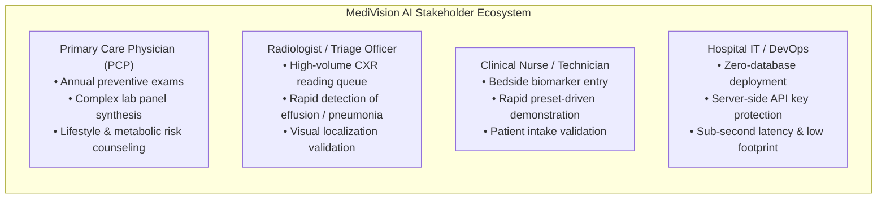

#### Persona 1: Primary Care Physician (Dr. Tarek)
* **Context:** Outpatient internal medicine clinic reviewing annual health screenings for an asymptomatic 55-year-old patient with elevated blood pressure and a family history of diabetes.
* **Workflow Need:** Enters 17 patient biomarkers into the Tabular Health Suite; immediately reviews simultaneous risk scores across 6 chronic targets; inspects WHO BMI classification; discusses preventative lifestyle adjustments.

#### Persona 2: Emergency / Triage Radiologist (Dr. Mona)
* **Context:** Busy emergency department triage receiving dozens of urgent chest X-rays hourly.
* **Workflow Need:** Drags an AP radiograph into the Chest X-ray Diagnostic Suite; reviews calibrated condition cards; switches between "Cardiomegaly" and "Effusion" Grad-CAM heatmaps to verify whether basal opacification represents pleural fluid or atelectatic collapse.

#### Persona 3: Bilingual Resident Physician (Dr. Youssef)
* **Context:** Academic hospital in Cairo communicating complex clinical risks to an Arabic-speaking patient and family.
* **Workflow Need:** Enables patient consent; interacts with the AI Assistant in Arabic; receives structured, culturally and linguistically natural explanations of the elevated cardiovascular risk score and radiographic findings.

### 2.2 System Functional Requirements Breakdown

The functional architecture maps directly to verified requirements established in the SRS:

```text
┌────────────────────────────────────────────────────────────────────────────────────────┐
│                        Functional Requirements Architecture                            │
└────────────────────────────────────────────────────────────────────────────────────────┘

 [Subsystem 1: Tabular ML Engine]
   ├── FR-ML-01: Ingestion of 17 Clinical & Laboratory Biomarkers
   ├── FR-ML-02: Reactive WHO BMI Computation & Categorization
   ├── FR-ML-03: Multi-Target Chronic Disease Prediction (6 Targets)
   ├── FR-ML-04: Binary Risk State Determination (Threshold = 0.5)
   └── FR-ML-05: Pre-Calibrated Clinical Presets (High-Risk vs. Healthy)

 [Subsystem 2: Computer Vision Diagnostic Engine]
   ├── FR-CV-01: Multi-Format Radiograph Ingestion (PNG, JPEG, WebP, TIFF <= 25MB)
   ├── FR-CV-02: Preprocessing Pipeline (EXIF Orientation, 256 Resize, 224 Crop, Norm)
   ├── FR-CV-03: Multi-Label Pathology Inference (DenseNet-121 Sigmoid Heads)
   ├── FR-CV-04: Calibrated Validation F1 Decision Boundary Gating
   └── FR-CV-08: Sample Case Library (Normal Baseline & Thoracic Pathology)

 [Subsystem 3: Grad-CAM Explainability Studio]
   ├── FR-CV-05: Convolutional Gradient Extraction from features.denseblock4
   ├── FR-CV-06: 4-Way Visual Studio (Overlay, Heatmap, Original, Side-by-Side)
   └── FR-CV-07: Interactive Condition Switching without Re-Inference

 [Subsystem 4: Conversational Clinical Assistant]
   ├── FR-AI-01: Bilingual Dialogue Generation (English and Arabic RTL)
   ├── FR-AI-02: Google Gemini Foundation Model Integration with Multi-Model Fallback
   ├── FR-AI-03: Contextual Grounding in Server-Verified JSON Inferences
   ├── FR-AI-04: Explicit Privacy Consent Gating (consent_to_send_health_data)
   └── FR-AI-05: Clinical Safety Guardrails & Prescribing Refusal

 [Subsystem 5: Platform & Microservice Architecture]
   ├── FR-SYS-01: RESTful Microservice Architecture with OpenAPI / Swagger Documentation
   ├── FR-SYS-02: Permissive Cross-Origin Resource Sharing (CORS) Middleware
   ├── FR-SYS-03: Single-Process Asset & Static SPA Delivery (/assets, /app)
   └── FR-SYS-04: Turnkey Environment Launcher (start_backend.bat, uv compatibility)
```

### 2.3 Quality Attributes & Non-Functional Requirements (NFRs)

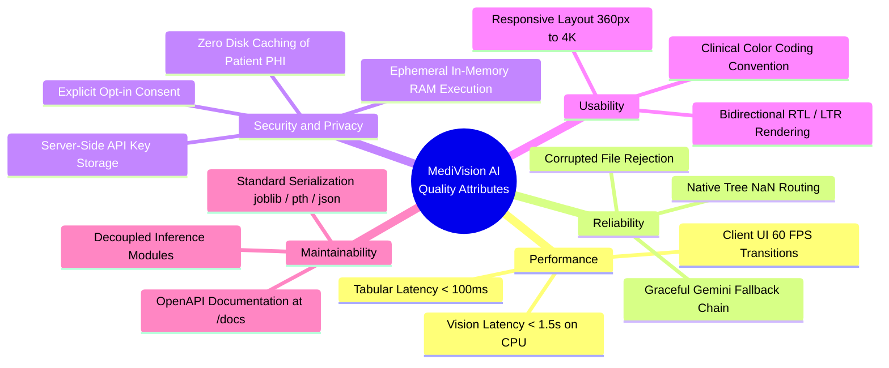

---

## 3. High-Level Architectural Design

### 3.1 Architectural Style & Design Principles

MediVision AI is structured according to a **Decoupled Multi-Tier Service-Oriented Architecture (SOA)**, integrating an asynchronous backend microservice with a reactive single-page client application.

#### Core Architectural Principles:
1. **Stateless Service-Oriented Design:** The backend maintains no persistent session state or transactional database. Each request is atomic, self-contained, and processed independently.
2. **In-Memory Ephemeral Pipeline:** Patient data, tabular vectors, and uploaded radiograph bytes exist exclusively in volatile memory (`io.BytesIO`) during request execution and are deallocated upon response completion.
3. **Decoupling of Diagnostic Engines:** The Tabular ML service and Computer Vision service operate as distinct computational modules (`backend/main.py` and `backend/src/backend/vision.py`), allowing independent model versioning, retraining, and testing without altering API contracts.
4. **Single-Process Delivery Option:** The backend acts both as a high-performance REST microservice and a static web server, eliminating the operational complexity of reverse proxies (e.g., NGINX) during local hospital workstation evaluation.

### 3.2 System Decomposition: The 4-Tier Architecture

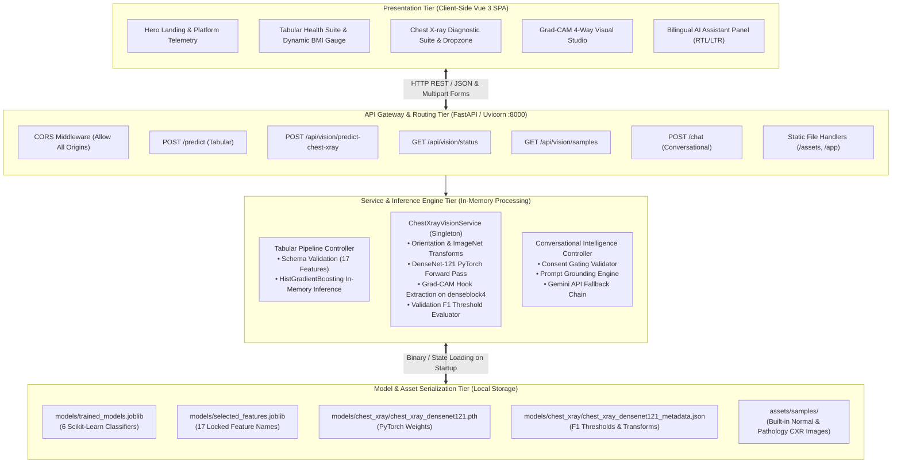

### 3.3 C4 Architectural Modeling

#### 3.3.1 Level 1: System Context Diagram

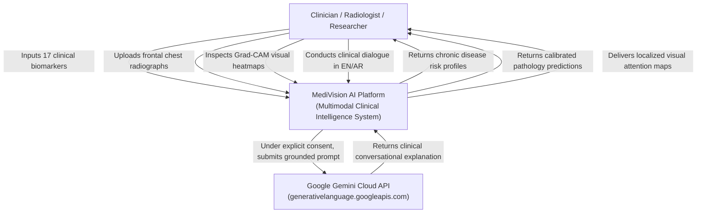

#### 3.3.2 Level 2: Container Diagram

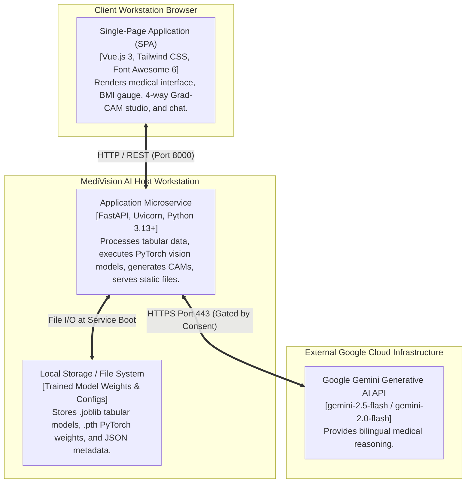

#### 3.3.3 Level 3: Component Diagram (Backend Microservice)

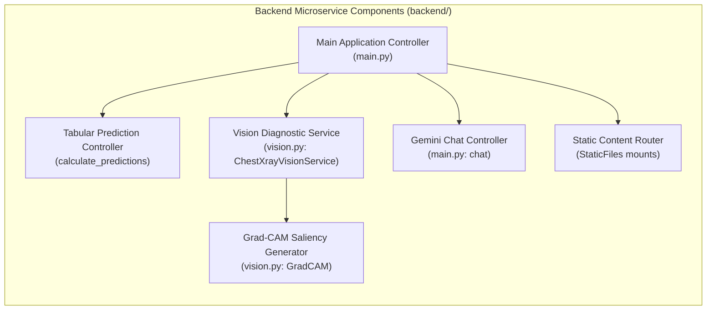

---

## 4. Detailed Subsystem & Module Design

### 4.1 Subsystem 1: Predictive Health Tabular Analytics Engine

#### 4.1.1 Theoretical Formulation & Algorithm Selection
Tabular clinical datasets frequently suffer from severe missingness. While standard gradient boosting frameworks require explicit data imputation (e.g., mean, median, k-NN), MediVision AI deploys **Scikit-Learn’s `HistGradientBoostingClassifier`**, which implements histogram binning inspired by LightGBM.

During tree construction, continuous variables are discretized into integer bins ($k = 256$). For missing observations (`NaN`), the algorithm evaluates both left-child and right-child partition gains:

$$
\Delta_{\text{split}} = \max \left( \text{Gain}(L \cup \{\text{NaN}\}, R), \, \text{Gain}(L, R \cup \{\text{NaN}\}) \right)
$$

The direction yielding the greatest reduction in the negative gradient of the log-loss objective is saved in the decision tree split node. At inference time, any missing patient laboratory reading is seamlessly routed down the optimal branch without requiring synthetic imputation.

#### 4.1.2 Feature Schema & Mathematical Mapping
The subsystem consumes an ordered 17-dimensional feature vector:

$$\mathbf{x} = [x_1, x_2, \dots, x_{17}]^T \in \mathbb{R}^{17}$$

```text
┌────────────────────────────────────────────────────────────────────────────────────────┐
│                        17 Tabular Clinical Input Biomarkers                            │
└────────────────────────────────────────────────────────────────────────────────────────┘

 [1. Demographics & Socioeconomics]
   • x1: age                  (Continuous, Years: 18.0 - 80.0)
   • x2: gender               (Categorical: 1 = Male, 2 = Female)
   • x3: ethnicity            (Categorical: 1 to 5)
   • x4: education            (Categorical: 1 to 5)
   • x5: income_poverty_ratio (Continuous: 0.0 - 5.0)

 [2. Anthropometric Measurements]
   • x6: height_cm            (Continuous: 120.0 - 220.0 cm)
   • x7: weight_kg            (Continuous: 30.0 - 250.0 kg)
   • x8: bmi                  (Continuous: 12.0 - 70.0 kg/m²)
   • x9: waist_cm             (Continuous: 50.0 - 180.0 cm)

 [3. Laboratory Blood Panels]
   • x10: hba1c               (Continuous: 3.5 - 18.0 %)
   • x11: fasting_glucose     (Continuous: 50.0 - 500.0 mg/dL)
   • x12: total_cholesterol   (Continuous: 80.0 - 500.0 mg/dL)
   • x13: hdl                 (Continuous: 10.0 - 150.0 mg/dL)
   • x14: triglycerides       (Continuous: 30.0 - 1000.0 mg/dL)
   • x15: ldl                 (Continuous: 20.0 - 400.0 mg/dL)

 [4. Behavioral & Lifestyle Metrics]
   • x16: ever_smoked         (Binary: 0 = No, 1 = Yes)
   • x17: sedentary_minutes   (Continuous: 0.0 - 1440.0 min/day)
```

#### 4.1.3 Multi-Target Chronic Disease Pipeline
The subsystem evaluates six independent binary classification models loaded from `models/trained_models.joblib`:

$$\hat{p}_d(\mathbf{x}) = \sigma(F_d(\mathbf{x})) = \frac{1}{1 + e^{-F_d(\mathbf{x})}}, \quad \forall d \in \{1, \dots, 6\}$$

| Target Disease Index ($d$) | Target Name | Serialized Model Key | ROC-AUC Metric | Decision Rule |
|:--------------------------:|:------------|:---------------------|:--------------:|:--------------|
| $d = 1$ | **Diabetes** | `target_diabetes` | **0.934** | $\hat{p}_1 \ge 0.5 \implies \text{AT RISK}$ |
| $d = 2$ | **Hypertension** | `target_hypertension` | **0.811** | $\hat{p}_2 \ge 0.5 \implies \text{AT RISK}$ |
| $d = 3$ | **Heart Disease** | `target_heart_disease` | **0.810** | $\hat{p}_3 \ge 0.5 \implies \text{AT RISK}$ |
| $d = 4$ | **Stroke** | `target_stroke` | **0.784** | $\hat{p}_4 \ge 0.5 \implies \text{AT RISK}$ |
| $d = 5$ | **Arthritis** | `target_arthritis` | **0.782** | $\hat{p}_5 \ge 0.5 \implies \text{AT RISK}$ |
| $d = 6$ | **Asthma** | `target_asthma` | **0.607** | $\hat{p}_6 \ge 0.5 \implies \text{AT RISK}$ |

---

### 4.2 Subsystem 2: Computer Vision Diagnostic Engine

#### 4.2.1 Deep Convolutional Network Architecture
The vision diagnostic subsystem deploys **DenseNet-121**, pre-trained on ImageNet and fine-tuned on the NIH ChestX-ray14 benchmark.


#### 4.2.2 Multi-Label Binary Classification Formulation
Because a single patient radiograph can present with concurrent pathologies (e.g., Cardiomegaly accompanied by bilateral Pleural Effusion), Softmax normalization is mathematically invalid. The network produces five independent logits $\mathbf{z} \in \mathbb{R}^5$, transformed into probabilities via the Sigmoid function:

$$p_k = \frac{1}{1 + e^{-z_k}}, \quad k \in \{1, \dots, 5\}$$

#### 4.2.3 Calibrated Validation F1 Decision Boundary Gates
To counter severe class prevalence imbalances in real-world clinical datasets (e.g., Pneumonia at 1.26% vs Infiltration at 17.78%), MediVision AI rejects the arbitrary default 0.5 decision cutoff. The system applies **validation F1-optimal operating thresholds** derived from empirical Precision-Recall sweeps on holdout data:

$$\text{Status}(k) = \begin{cases} \text{"DETECTED"} & \text{if } p_k \ge \tau_k \\ \text{"NOT DETECTED"} & \text{if } p_k < \tau_k \end{cases}$$

```text
┌────────────────────────────────────────────────────────────────────────────────────────┐
│               Calibrated Decision Thresholds vs. Default 0.5 Boundary                  │
└────────────────────────────────────────────────────────────────────────────────────────┘

 Pathology        Prevalence   Test ROC-AUC   Optimal F1 Cutoff (τk)   Default (0.5) Failure Mode
 ─────────────────────────────────────────────────────────────────────────────────────────
 Cardiomegaly        2.74%        0.918              0.9395            High false positive rate
 Pleural Effusion   11.39%        0.872              0.7896            Suboptimal sensitivity
 Atelectasis        10.21%        0.799              0.6499            Misses subtle volume loss
 Pneumonia           1.26%        0.736              0.7666            Severe false alarms under 0.5
 Infiltration       17.78%        0.710              0.5493            Optimal balance for opacity
```

---

### 4.3 Subsystem 3: Explainable AI (XAI) Grad-CAM Saliency Studio

#### 4.3.1 Mathematical Derivation of Gradient-Weighted Class Activation Mapping
The Grad-CAM module (`GradCAM` in `vision.py`) extracts spatial attention maps directly from the final convolutional block (`features.denseblock4`) of DenseNet-121.

1. **Forward Pass:** The feature activation tensor $A \in \mathbb{R}^{1024 \times 7 \times 7}$ is captured via a registered forward hook on `denseblock4`.
2. **Backward Pass:** The output logit $Y^c$ for condition $c$ is backpropagated to compute the partial derivative gradient tensor:

$$\frac{\partial Y^c}{\partial A_{i, j}^k}$$

3. **Neuron Importance Weighting ($\alpha_k^c$):** Spatial dimensions ($U \times V = 7 \times 7 = 49$) are global-average pooled:

$$\alpha_k^c = \frac{1}{Z} \sum_{i=1}^U \sum_{j=1}^V \frac{\partial Y^c}{\partial A_{i, j}^k}$$

4. **Linear Combination and Positive Rectification (ReLU):**

$$L_{\text{Grad-CAM}}^c = \text{ReLU}\left( \sum_{k=1}^{1024} \alpha_k^c A^k \right)$$

Applying the **ReLU** function ensures that only spatial features that exert a **positive influence** on the target pathology logit are visualized, discarding suppressing or irrelevant activations.

#### 4.3.2 Heatmap Rendering & Visual Blending Pipeline

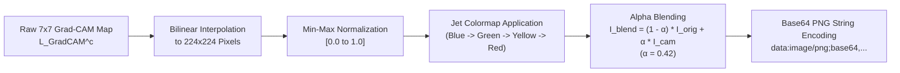

#### 4.3.3 Single-Inference Multi-Condition Saliency Generation
A major performance innovation of MediVision AI is that **all five Grad-CAM maps are calculated and Base64-encoded during the initial server forward-backward pass**:
* The returned JSON response includes `overlays_by_condition` and `heatmaps_by_condition` dictionaries containing pre-rendered strings for all 5 pathologies.
* Clinicians can click any pathology badge in the frontend UI to instantly inspect that condition's visual attention focus without incurring additional network latency or re-running inference.

---

### 4.4 Subsystem 4: Conversational Clinical Intelligence Assistant

#### 4.4.1 Google Gemini Integration & Foundation Model Architecture
The conversational assistant integrates Google Gemini foundation models utilizing the modern `google-genai` Python SDK. The system defaults to `gemini-2.5-flash`, configured with a deterministic sampling temperature ($\tau = 0.3$) to minimize linguistic hallucination and maintain clinical accuracy.

#### 4.4.2 Multi-Tier Automated Fallback Architecture
To safeguard system availability against cloud quota restrictions or regional model deprecations, the backend implements a resilient multi-tier fallback sequence:

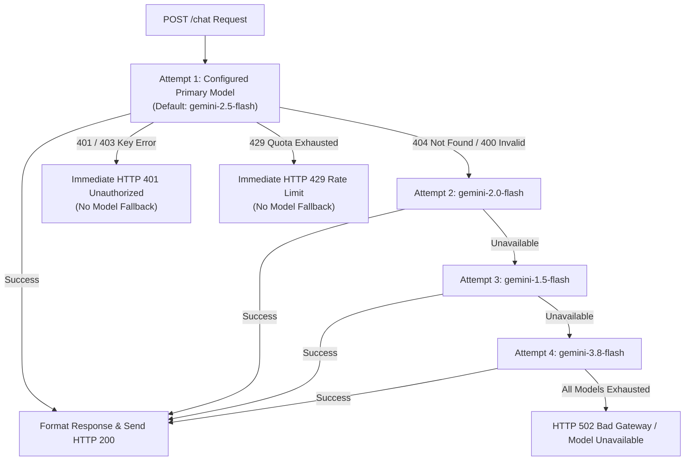

#### 4.4.3 Prompt Grounding Engine & Safety System Instructions
The assistant prompt is assembled dynamically from four structured context partitions:

```text
┌────────────────────────────────────────────────────────────────────────────────────────┐
│                           Gemini Prompt Assembly Pipeline                              │
└────────────────────────────────────────────────────────────────────────────────────────┘

 [1. System Clinical Guardrails]
   • Bilingual response generation matching user language (Arabic / English).
   • Mandate: System is strictly an assistive CDSS; not an autonomous diagnostic agent.
   • Absolute refusal to generate pharmaceutical dosages, prescriptions, or drug schedules.
   • Clarification that Grad-CAM heatmaps highlight convolutional attention, not definitive tissue histology.
   • Disclosure that the asthma tabular model possesses limited discrimination (ROC-AUC ~0.607).

 [2. Injected Verified Telemetry (Active ONLY when consent = True)]
   • Verified Tabular ML JSON Results: { Diabetes: 78.4% (AT RISK), BMI: 28.7, ... }
   • Verified Vision Findings JSON: { Primary: Pneumonia, Cardiomegaly: 0.1% (NORMAL), ... }

 [3. Conversation Context Window]
   • Rolling dialogue history (most recent 10 messages).

 [4. User Clinical Query]
   • Current natural language input string.
```

#### 4.4.4 Privacy-Gated Consent Control Architecture
The platform enforces a strict privacy gate:
* If the user submits a query with `profile` populated while `consent_to_send_health_data = false`, the backend immediately raises **HTTP 400 Bad Request**:
  > *"Consent is required before processing patient-specific information with Gemini."*
* When consent is omitted, general medical inquiries are answered without transmitting patient data to Google Cloud.

---

### 4.5 Subsystem 5: Frontend Single-Page Application (SPA)

#### 4.5.1 Reactive State Management
The frontend is built as a reactive Single-Page Application utilizing **Vue.js 3** mounted via CDN (`frontend/index.html`). The application coordinates state across three primary views:

```text
┌────────────────────────────────────────────────────────────────────────────────────────┐
│                           Vue.js 3 Application View Router                             │
└────────────────────────────────────────────────────────────────────────────────────────┘

 [Landing / Overview View] (currentView = 'landing')
   ├── Hero Section with Platform Logo & Status Indicators
   ├── Telemetry Metrics Grid (0.934 Peak AUC, 0.807 Vision AUC, 17 Biomarkers)
   └── Interactive Dual-Engine Navigation Launchers

 [Tabular Analytics Suite] (currentView = 'tabular')
   ├── 17 Input Controls grouped into Demographics, Anthropometrics, Labs, Lifestyle
   ├── Reactive WHO BMI Gauge (Underweight, Normal, Overweight, Obese)
   ├── Pre-Calibrated Clinical Presets ("High-Risk Patient" and "Healthy Patient")
   ├── 6 Disease Risk Cards with Gradient Progress Bars
   └── Printable Medical Summary Mode (@media print)

 [Chest X-ray Diagnostic Suite] (currentView = 'vision')
   ├── Drag-and-Drop Image Dropzone with Client-Side Validation
   ├── Sample Radiograph Loaders ("Normal Baseline" and "Thoracic Pathology")
   ├── 5 Calibrated Pathology Diagnostic Cards with Validation F1 Badges
   └── Grad-CAM 4-Way Visual Studio (Overlay, Heatmap, Original, Side-by-Side)

 [Persistent Floating AI Assistant Widget] (isChatOpen = true/false)
   ├── Expandable Modal with Responsive RTL / LTR Directionality
   ├── Explicit Opt-in Patient Privacy Consent Switch
   ├── Language Selector (Auto, Arabic, English)
   └── Quick Clinical Suggestion Chips
```

#### 4.5.2 Smart Host Auto-Detection
The client dynamically resolves the backend REST API endpoint:
* If loaded via the backend static mount (`http://localhost:8000/app/`), it sets `apiBase = window.location.origin`.
* If opened as a local file (`file:///.../frontend/index.html`), it defaults automatically to `http://localhost:8000`.

---

## 5. Behavioral & Interaction Modeling

### 5.1 End-to-End Sequence Diagrams

#### 5.1.1 Tabular Health Risk Prediction Sequence

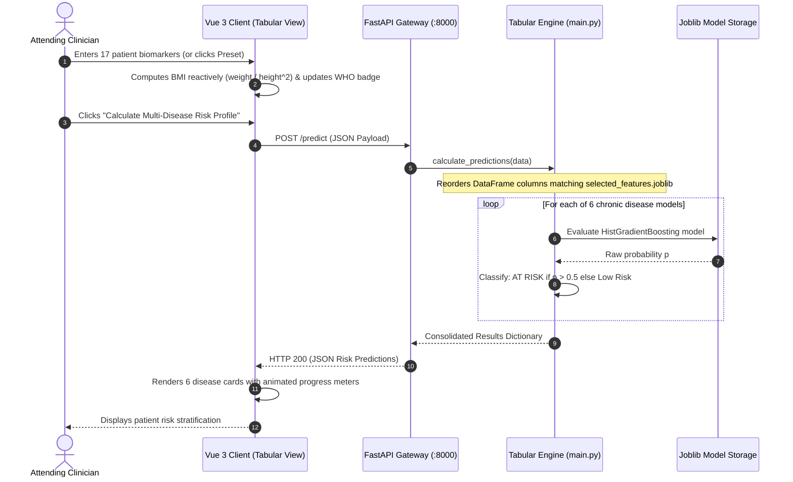

#### 5.1.2 Chest X-ray Diagnostics & Grad-CAM Generation Sequence

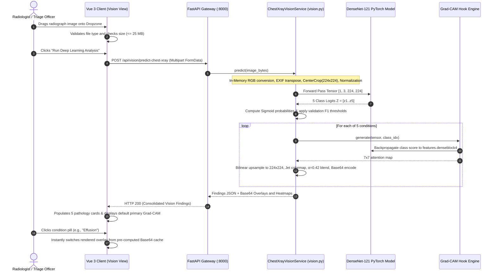

#### 5.1.3 Grounded Clinical Dialogue with Consent Gating Sequence

```mermaid
sequenceDiagram
    autonumber
    actor Clinician as Clinician / Patient
    participant UI as Vue 3 Client (Chat Widget)
    participant API as FastAPI Gateway (:8000)
    participant Chat as Chat Controller (main.py)
    participant Gemini as Google Gemini Cloud API

    Clinician->>UI: Opens chat & enters clinical query
    alt Consent Switch is UNCHECKED
        UI->>API: POST /chat (message, consent=false, profile=null)
        API->>Chat: Assemble general medical prompt
    else Consent Switch is CHECKED
        UI->>API: POST /chat (message, consent=true, profile=PatientData, vision_findings=JSON)
        API->>Chat: Validates consent; calculates fresh predictions; binds vision findings
        Note over Chat: Builds grounded prompt with system guardrails & verified JSON outputs
    end
    Chat->>Gemini: client.models.generate_content(gemini-2.5-flash)
    alt Primary Model Fails (e.g. 404 / 400)
        Chat->>Gemini: Attempt Fallback (gemini-2.0-flash / 1.5 / 3.8)
    end
    Gemini-->>Chat: Returns generated response text
    Chat-->>API: Consolidated reply dictionary
    API-->>UI: HTTP 200 { reply: "..." }
    UI->>UI: Renders response in chat window (with Arabic RTL or English LTR styling)
    UI-->>Clinician: Displays grounded, assistive clinical explanation
```

---

## 6. Data & Schema Modeling

### 6.1 Data Flow Diagrams (DFD)

#### 6.1.1 DFD Level 0 (System Context Diagram)

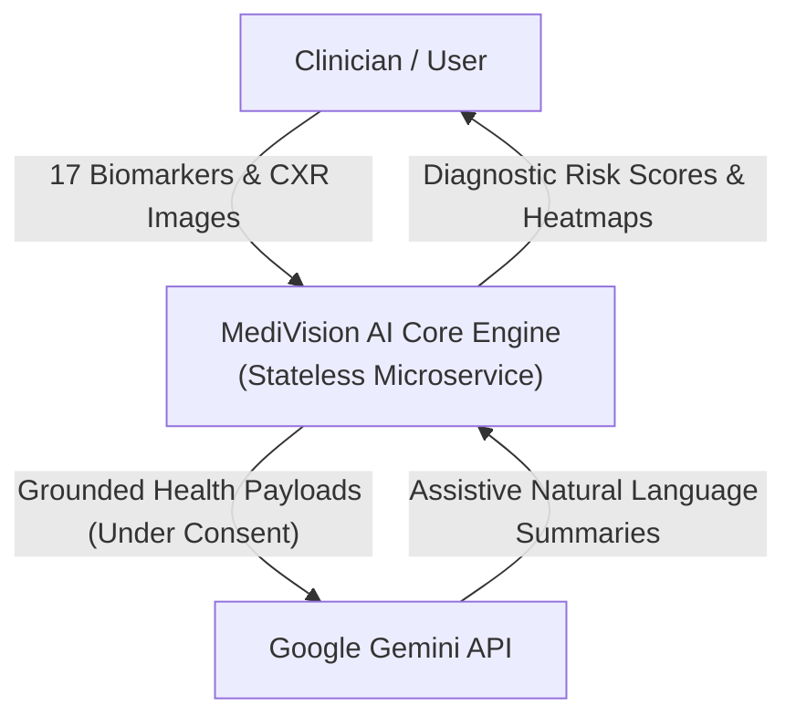

#### 6.1.2 DFD Level 1 (Subsystem Data Flow)

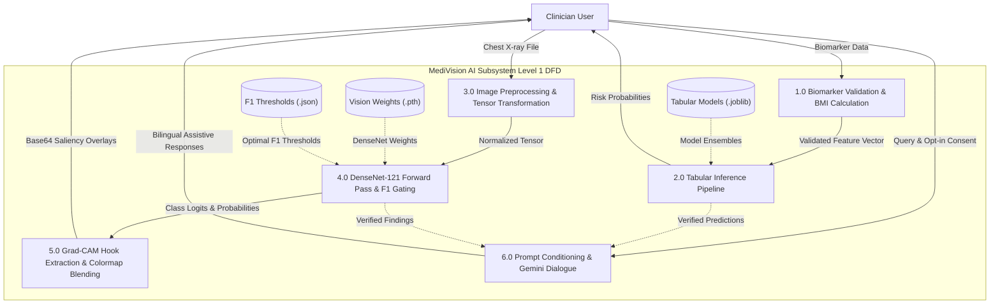

### 6.2 Data Contracts & Pydantic Schemas

```text
┌────────────────────────────────────────────────────────────────────────────────────────┐
│                           Pydantic Data Contracts (API Tier)                           │
└────────────────────────────────────────────────────────────────────────────────────────┘

 [Schema: PatientData]
   age: float (18.0 - 80.0)
   gender: int (1 = Male, 2 = Female)
   ethnicity: int (1 - 5)
   bmi: float (12.0 - 70.0)
   waist_cm: float (50.0 - 180.0)
   weight_kg: float (30.0 - 250.0)
   height_cm: float (120.0 - 220.0)
   hba1c: float (3.5 - 18.0)
   fasting_glucose: float (50.0 - 500.0)
   total_cholesterol: float (80.0 - 500.0)
   hdl: float (10.0 - 150.0)
   triglycerides: float (30.0 - 1000.0)
   ldl: float (20.0 - 400.0)
   ever_smoked: int (0 or 1)
   sedentary_minutes: float (0.0 - 1440.0)
   education: int (1 - 5)
   income_poverty_ratio: float (0.0 - 5.0)

 [Schema: ChatMessage]
   role: Literal["user", "assistant"]
   content: str (1 - 2000 chars)

 [Schema: ChatRequest]
   message: str (1 - 2000 chars)
   language: Literal["auto", "ar", "en"] = "auto"
   history: List[ChatMessage] (max 12 messages)
   profile: Optional[PatientData] = None
   consent_to_send_health_data: bool = False
   vision_findings: Optional[Dict[str, Any]] = None
```

### 6.3 Vision Inference Output Schema
The `POST /api/vision/predict-chest-xray` endpoint produces a rich JSON document containing statistical metrics, detection flags, clinical severity levels, and pre-computed visual strings:

```json
{
  "findings": [
    {
      "condition": "Cardiomegaly",
      "probability": 0.0012,
      "probability_pct": "0.1%",
      "confidence_pct": 0.1,
      "threshold": 0.9395,
      "threshold_pct": "93.9%",
      "detected": false,
      "status": "NOT DETECTED",
      "severity": "normal",
      "roc_auc": 0.918,
      "sensitivity": 0.393,
      "specificity": 0.984
    },
    {
      "condition": "Pneumonia",
      "probability": 0.8142,
      "probability_pct": "81.4%",
      "confidence_pct": 81.4,
      "threshold": 0.7666,
      "threshold_pct": "76.7%",
      "detected": true,
      "status": "DETECTED",
      "severity": "high",
      "roc_auc": 0.736,
      "sensitivity": 0.21,
      "specificity": 0.962
    }
  ],
  "detected_conditions": ["Pneumonia"],
  "has_detected_pathology": true,
  "primary_condition": "Pneumonia",
  "summary": "Thoracic pathology detected: Pneumonia (81.4%, threshold: 76.7%).",
  "visualizations": {
    "original": "data:image/png;base64,...",
    "overlay": "data:image/png;base64,...",
    "heatmap": "data:image/png;base64,...",
    "overlays_by_condition": {
      "Cardiomegaly": "data:image/png;base64,...",
      "Pneumonia": "data:image/png;base64,..."
    },
    "heatmaps_by_condition": {
      "Cardiomegaly": "data:image/png;base64,...",
      "Pneumonia": "data:image/png;base64,..."
    }
  },
  "metadata": {
    "model_name": "MediVision AI Chest X-ray DenseNet-121",
    "architecture": "DenseNet-121 (Convolutional Feature Extractor)",
    "target_layer": "features.denseblock4 (Grad-CAM Localization)",
    "test_macro_roc_auc": 0.807,
    "clinical_status": "Research and development decision support only."
  }
}
```

---

## 7. Interface & Communication Design

### 7.1 RESTful API Endpoint Specifications

| HTTP Verb | Path | Request Content-Type | Response Schema / Status | Description |
|:----------|:-----|:---------------------|:------------------------|:------------|
| `GET` | `/` | None | JSON / HTTP 200 | Health check: Returns system readiness, model loading states, and Gemini status. |
| `POST` | `/predict` | `application/json` | JSON / HTTP 200 | Computes multi-target chronic disease probabilities across 6 conditions. |
| `POST` | `/api/vision/predict-chest-xray` | `multipart/form-data` | JSON / HTTP 200 | Processes radiograph file, applies F1 cutoffs, and returns Grad-CAM heatmaps. |
| `POST` | `/predict-chest-xray` | `multipart/form-data` | JSON / HTTP 200 | Direct alias for `/api/vision/predict-chest-xray`. |
| `GET` | `/api/vision/status` | None | JSON / HTTP 200 | Returns vision model telemetry, layer hooks, and optimal F1 cutoffs. |
| `GET` | `/vision/status` | None | JSON / HTTP 200 | Direct alias for `/api/vision/status`. |
| `GET` | `/api/vision/samples` | None | JSON / HTTP 200 | Returns directory listing of built-in sample radiograph files. |
| `GET` | `/api/vision/samples/{filename}`| None | `image/png` / HTTP 200 | Serves raw sample radiograph file for frontend preview. |
| `POST` | `/chat` | `application/json` | JSON / HTTP 200 | Conversational assistant interface; executes grounded Gemini queries. |
| Static | `/assets/*` | None | Static Files | Serves branding graphics and built-in sample images. |
| Static | `/app/*` | None | HTML / Static Files | Serves the Vue 3 single-page application directly to browsers. |
| `GET` | `/docs` | None | HTML / Swagger UI | Interactive OpenAPI 3.0 documentation explorer. |

### 7.2 Human-Computer Interaction (HCI) & UI Design

The user interface implements established human-computer interaction principles for clinical software:
1. **Minimization of Cognitive Load:** Diagnostic findings are categorized into intuitive clinical color codes (Red = High Risk / Detected; Amber = Elevated Risk; Green = Normal / Low Risk).
2. **Preventing Erroneous Entry:** Input fields validate clinical bounds, preventing biological impossibilities (e.g., negative blood glucose or zero height).
3. **Preset Accelerators:** Clinicians evaluating the system can load pre-calibrated cohorts ("High-Risk Patient" vs. "Healthy Patient") with a single click, eliminating tedious manual entry during system verification.
4. **Bidirectional Fluidity:** Arabic language rendering enforces clean Right-to-Left (RTL) typography (`font-cairo`, mirrored chat bubbles), ensuring natural communication for regional healthcare workers.

---

## 8. Security, Privacy & Clinical Safety Engineering

### 8.1 Zero-Retention Ephemeral Architecture

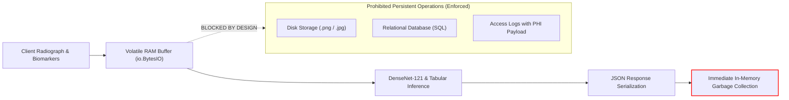

* **Zero Disk Persistence:** No uploaded radiograph or patient record is written to disk or local databases.
* **Stateless Lifecycles:** Python's garbage collection immediately deallocates image memory buffers once the HTTP connection terminates.
* **PHI Sanitization:** The platform does not capture patient names, national identity numbers, medical record numbers (MRNs), or phone numbers.

### 8.2 API Key Isolation & Protection
* Commercial LLM API keys (`GEMINI_API_KEY`) are stored exclusively in server-side environment variables (`backend/.env`).
* No keys or authorization headers are bundled into client-side HTML, CSS, or JavaScript assets.
* Client requests pass through the backend proxy route `POST /chat`, preventing key sniffing or client token extraction.

### 8.3 Clinical Scope Limitations & Assistive Guardrails
* **SaMD Regulatory Scope:** MediVision AI is classified as an assistive clinical decision aid. All screens display prominent disclaimers establishing that predictions are statistical estimates designed to assist licensed practitioners.
* **Refusal of Dosing Instructions:** System prompts rigorously instruct the LLM:
  > *"Do not prescribe specific pharmaceutical dosages or substitute for licensed clinician judgment."*

---

## 9. Physical Architecture & Deployment Design

### 9.1 Hardware & Environment Prerequisites

```text
┌────────────────────────────────────────────────────────────────────────────────────────┐
│                         Physical Deployment Specifications                             │
└────────────────────────────────────────────────────────────────────────────────────────┘

 [Workstation / Server Requirements]
   • Processor: Quad-Core x86-64 CPU (Intel Core i5/i7/i9 or AMD Ryzen)
   • RAM: Minimum 8 GB (16 GB recommended for concurrent PyTorch operations)
   • Storage: 2 GB free disk space for model weights and virtual environment
   • Graphics: Optional; CPU execution fully supported via PyTorch CPU tensors
   • Operating Systems: Windows 10/11, Ubuntu 20.04/22.04 LTS, macOS 12+

 [Software Prerequisites]
   • Python Runtime: Python 3.11 to Python 3.13
   • Package Management: uv (recommended) or standard pip
   • Network Access: Port 8000 (local microservice); outbound HTTPS port 443 (for Gemini)
   • Web Browser: Modern evergreen browser (Chrome 100+, Edge 100+, Firefox 100+, Safari 15+)
```

### 9.2 Turnkey Windows Execution Architecture

MediVision AI includes a streamlined deployment script (`start_backend.bat`) that automates environment detection and service booting:

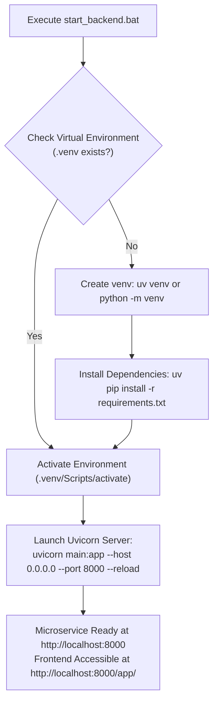

---

## 10. Design Traceability Matrix (Requirements to Design)

This matrix maps functional and non-functional requirements from the SRS to specific architectural components and source files:

| Requirement ID | Requirement Summary | Architectural Design Module | Implementation Source Location | Verification Status |
|:--------------:|:--------------------|:----------------------------|:-------------------------------|:-------------------:|
| **FR-ML-01** | Ingest 17 Clinical Biomarkers | `PatientData` Schema & Tabular Controller | `backend/main.py:100-118` | **Verified** |
| **FR-ML-02** | Reactive Dynamic BMI Calculation | Vue 3 Reactive Computed Property | `frontend/index.html:1200-1230` | **Verified** |
| **FR-ML-03** | 6 Chronic Disease Predictions | `calculate_predictions` Function | `backend/main.py:119-152` | **Verified** |
| **FR-ML-04** | Binary Risk Categorization (0.5) | Tabular Inference Logic | `backend/main.py:141-143` | **Verified** |
| **FR-ML-05** | Clinical Cohort Presets | Frontend Preset Handlers (`loadPreset`) | `frontend/index.html:1250-1280` | **Verified** |
| **FR-CV-01** | Radiograph Multi-Format Upload | FastAPI `UploadFile` & PIL Stream | `backend/main.py:167-205` | **Verified** |
| **FR-CV-02** | CXR Normalization Pipeline | `eval_transform` Pipeline | `backend/src/backend/vision.py:31-36` | **Verified** |
| **FR-CV-03** | DenseNet-121 Multi-Label Head | Custom Classifier Sequential Block | `backend/src/backend/vision.py:44-54` | **Verified** |
| **FR-CV-04** | Calibrated Validation F1 Gates | Threshold Evaluation Logic | `backend/src/backend/vision.py:330-355` | **Verified** |
| **FR-CV-05** | Grad-CAM Hook Extraction | `GradCAM` Class Hook Architecture | `backend/src/backend/vision.py:57-115` | **Verified** |
| **FR-CV-06** | 4-Way Grad-CAM Visual Studio | Vue 3 Visual Studio Container | `frontend/index.html:850-950` | **Verified** |
| **FR-CV-07** | Interactive Condition Switching | In-Memory Precomputed CAM Caching | `backend/src/backend/vision.py:360-385` | **Verified** |
| **FR-CV-08** | Built-in Sample Image Assets | Static Sample Endpoint `/api/vision/samples`| `backend/main.py:221-245` | **Verified** |
| **FR-AI-01** | Bilingual Natural Language Dialogue | System Clinical Prompt & RTL Layout | `backend/main.py:310-329` | **Verified** |
| **FR-AI-02** | Google Gemini Multi-Model Fallback | Dynamic Client Fallback Loop | `backend/main.py:360-397` | **Verified** |
| **FR-AI-03** | Context Grounding in Server JSON | JSON Payload Context Assembly | `backend/main.py:330-355` | **Verified** |
| **FR-AI-04** | Privacy Consent Gating | Explicit Boolean Verification Gate | `backend/main.py:286-293` | **Verified** |
| **FR-AI-05** | Safety Guardrails & No Dosing | System Prompt Safety Injunctions | `backend/main.py:317-327` | **Verified** |
| **FR-SYS-01**| RESTful Microservice Architecture | FastAPI Application Instance | `backend/main.py:61-69` | **Verified** |
| **FR-SYS-03**| Single-Process Static Delivery | StaticFiles Mounts (`/assets`, `/app`) | `backend/main.py:71-79` | **Verified** |
| **FR-SYS-04**| Turnkey Environment Launcher | Batch Script Launcher | `start_backend.bat:1-35` | **Verified** |

---

## 11. Conclusion & Architectural Roadmap

### 11.1 Design Summary
The System Analysis and Design of MediVision AI addresses the fragmentation of contemporary healthcare artificial intelligence. By pairing histogram-based gradient boosting on CDC NHANES survey data, DenseNet-121 deep transfer learning on NIH ChestX-ray14 imaging, and grounded Google Gemini conversational intelligence, the architecture establishes a robust, privacy-preserving multimodal decision-support platform.

Key design innovations verified in this document include:
* Native tolerance for clinical missingness without synthetic imputation bias.
* Calibrated validation F1 decision boundaries that prevent sensitivity collapse under extreme class imbalance.
* Single-pass Grad-CAM generation enabling instantaneous multi-condition visual toggling.
* Strict in-memory ephemeral execution ensuring patient confidentiality.

### 11.2 Future Architectural Roadmap
* **PACS / DICOM Protocol Integration:** Integrating a native DICOM web listener (DIMSE / DICOMweb) to ingest uncompressed 16-bit medical imaging directly from hospital archives.
* **Federated On-Premise Training:** Extending the model training architecture to support federated learning across multi-institutional hospital networks without centralizing sensitive patient cohorts.
* **Multimodal Cross-Attention Transformers:** Exploring unified vision-language-tabular architectures (e.g., Perceiver or Med-Flamingo variants) to model complex cross-modal interactions directly within neural representations.

---

*End of System Analysis & Design Document.*
